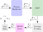

# DINO-QPM: Adapting Visual Foundation Models for Globally Interpretable Image Classification

[](https://arxiv.org/abs/2604.07166)
<p align="center">
  
</p>

<div align="center">

<em>Overview of our proposed DINO-QPM. The pipeline processes the (a) input image using the frozen backbone to produce patch embeddings, which are transformed by the interpretability adapter to obtain a globally interpretable image classification. We compare the diffuse saliency map of (b) DINO GradCAM, extracted from a linear probed DINO model, with our (c) DINO-QPM local explanation. The local explanation can be further decomposed into its (d) class-independent diverse features. Compared to the baseline, we observe a drastic increase in localisation quality, showcasing how our interpretability adapter successfully isolates semantically meaningful features.</em>

</div>

## Abstract

Although visual foundation models like DINOv2 provide state-of-the-art performance as feature extractors, their complex, high-dimensional representations create substantial hurdles for interpretability. This work proposes DINO-QPM, which converts these powerful but entangled features into contrastive, class-independent representations that are interpretable by humans. DINO-QPM is a lightweight interpretability adapter that pursues globally interpretable image classification, adapting the Quadratic Programming Enhanced Model (QPM) to operate on strictly frozen DINO backbones. While classification with visual foundation models typically relies on the CLS token, we deliberately diverge from this standard. By leveraging average-pooling, we directly connect the patch embeddings to the model's features and therefore enable spatial localisation of DINO-QPM's globally interpretable features within the input space. Furthermore, we apply a sparsity loss to minimise spatial scatter and background noise, ensuring that explanations are grounded in relevant object parts. With DINO-QPM we make the level of interpretability of QPM available as an adapter while exceeding the accuracy of DINOv2 linear probe. Evaluated through an introduced Plausibility metric and other interpretability metrics, extensive experiments demonstrate that DINO-QPM is superior to other applicable methods for frozen visual foundation models in both classification accuracy and explanation quality.

## Architecture

<table width="100%">
  <tr valign="middle">
    <td width="50%" align="center">
      
      <br>
    </td>
    <td width="50%">
      <p>The input image is first processed by a <b>frozen backbone</b> (e.g. DINOv2), which yields patch-level feature maps and a global vector (CLS-like token). Although DINO-QPM relies exclusively on the patch embeddings, alternative extraction strategies (such as direct global-vector usage or mixed pooling) are fully supported and selectable via the configuration.</p>
      <p>We then apply the <b>MLP</b> to extract domain-specific representations, which are subsequently <b>average-pooled</b> to form the feature vector. Following this, our <b>BLDD Layer</b> performs a binary low-dimensional transformation: it selects a global pool of 50 features and allocates exactly 5 of these to each class.</p>
      <p>This process generates the final output vector, containing a likelihood score for every class. The highest score ultimately dictates the predicted classification.</p>
    </td>
  </tr>
</table>
<br>

## Results

<p align="center">
  
</p>

<div align="center">

*Comparison with state-of-the-art interpretable models. We report Accuracy, Plausibility, SID@5, Class-Independence, and Contrastiveness (all metrics in %). Features of a model are localised if they have a direct connection to the feature vector used for classification. The Plausibility metric is evaluated only on CUB-2011 due to the availability of segmentation masks. Dense* $\boldsymbol{F}^{\text{froz}}$ *is the dense model of DINO-QPM and DINOv2* $\boldsymbol{f}_{\text{CLS}}^{\text{froz}}$ *Linear Probe is a linear probe trained on top of the frozen `CLS` representation. For DINO-SLDD and DINO-QSENN, we employ a pipeline closely resembling our proposed method, with the exception of the feature selection mechanisms, which follow prior work. [^1][^2][^6]*

</div>

## DINO-QPM: A Global Interpretability Adapter

<p align="center">
  
</p>

<div align="center">

*Comparison of a Brewer's Blackbird image with a Rusty Blackbird image. From the selected features* $\mathcal{F}^{\ast}$, $N_f^{\hat{c}}=5$ *utilised features were selected for both classes using the QP; the corresponding feature maps from* $\boldsymbol{F}$ *are visualised as saliency maps. Both classes share 4 out of the 5 features and can thus be distinguished by the non-shared features. Notably, the model differentiates the Brewer's Blackbird using feature 24, which localises the beak. This aligns perfectly with established ornithological expertise, where beak morphology is considered a primary diagnostic trait.[^3][^4]*

</div>

## Code

### Installation

A Conda distribution (Anaconda or Miniconda) is needed.[^5] From the repository root:

```bash
conda env create -f environment.yml
conda activate DINO-QPM
pip install -e .
```

`environment.yml` pins the package versions the code was tested with (Python 3.10, PyTorch 2.4.1). On Linux, the PyTorch wheel includes CUDA 12.1; for another CUDA version or a CPU-only machine, install `torch`/`torchvision` first as described on [pytorch.org](https://pytorch.org/get-started/locally/) and remove them from `environment.yml`.

#### Gurobi licence

The QPM feature selection solves a quadratic program with [Gurobi](https://www.gurobi.com/). The `gurobipy` package from pip ships with a size-limited licence that is too small for this problem, so **training (fine-tuning) needs a full Gurobi licence**; academics get one free of charge ([academic licences](https://www.gurobi.com/academia/academic-program-and-licenses/)). Solving takes up to 3 hours per run (`finetune.time_limit`). Evaluation, inference and the pretrained models below do not need Gurobi.

### Pretrained Models

We release DINO-QPM checkpoints for CUB-200-2011 and Stanford Cars, 5 seeds each, as the dense model and the fine-tuned (sparse, interpretable) model: 20 checkpoints in total.

> **These are reproductions, not the checkpoints behind the paper's tables.** The original checkpoints were not kept. The released models were retrained with the same architecture, losses and hyperparameters, but with a shorter schedule: 10 dense epochs and 25 fine-tuning epochs with fine-tuning batch size 16 (paper: 40 and 50 epochs, batch size 32), and 5 seeds per dataset, as for all models in the paper except the main DINO-QPM configuration, which the paper accidentally evaluated over 15 seeds. They were trained with our internal training code, a successor of this repository; their accuracy was re-computed with this repository and matches the values logged at training time exactly.

Test accuracy (%) of the released checkpoints, mean ± standard deviation over 5 seeds:

| Model | CUB-200-2011 | Stanford Cars |
|---|---|---|
| DINO-QPM (fine-tuned), released | 88.4 ± 0.3 | 93.7 ± 0.1 |
| DINO-QPM (fine-tuned), paper | 88.3 ± 0.3 | 94.0 ± 0.2 |
| Dense model, released | 80.7 ± 0.3 | 91.7 ± 0.2 |
| Dense model, paper | 78.1 ± 0.3 | 92.9 ± 0.1 |

Per seed:

| Seed | CUB dense | CUB fine-tuned | Cars dense | Cars fine-tuned |
|---|---|---|---|---|
| 2847391 | 81.0 | 88.3 | 91.8 | 93.7 |
| 3748291 | 80.9 | 88.9 | 91.4 | 93.7 |
| 5647382 | 80.2 | 88.1 | 91.6 | 93.8 |
| 6190452 | 80.6 | 88.4 | 91.9 | 93.6 |
| 9182736 | 80.6 | 88.1 | 91.6 | 93.4 |

The checkpoints are hosted on the [Hugging Face Hub](https://huggingface.co/HF_REPO_PLACEHOLDER) and archived on [Zenodo](https://doi.org/ZENODO_DOI_PLACEHOLDER) (DOI `ZENODO_DOI_PLACEHOLDER`). Each checkpoint is a `model.safetensors` file (the interpretability adapter on top of the frozen backbone; ~44 MB) with the `config.yaml` it was trained with. The fine-tuned checkpoints also store the QPM feature selection, so no other files are needed. The frozen DINOv2 ViT-B/14 (with registers) backbone is downloaded automatically from Meta on first use.

Available seeds: `2847391`, `3748291`, `5647382`, `6190452`, `9182736`.

#### From the Hugging Face Hub

The checkpoint is downloaded and cached on first use:

```bash
# evaluate the fine-tuned CUB model of seed 2847391
python main.py evaluate --pretrained cub/2847391/finetune --eval-mode accuracy

# dense Stanford Cars model of another seed
python main.py evaluate --pretrained cars/3748291/dense --eval-mode accuracy

# predict and visualise your own images
python main.py inference --pretrained cub/2847391 --image-path /path/to/image_or_folder
```

In Python:

```python
from dino_qpm.hub import load_pretrained

model, config = load_pretrained("cub", seed=2847391, stage="finetune")
```

`model` is the interpretability adapter; it takes the patch embeddings of the frozen backbone as input (see `dino_qpm/inference/main.py` for a complete forward pass).

#### From Zenodo

The Zenodo record holds one archive per dataset (`dino-qpm-cub.zip`, `dino-qpm-cars.zip`) with the same layout as the Hugging Face repository, plus `SHA256SUMS`:

```bash
wget https://zenodo.org/records/ZENODO_RECORD_PLACEHOLDER/files/dino-qpm-cub.zip
wget https://zenodo.org/records/ZENODO_RECORD_PLACEHOLDER/files/SHA256SUMS
sha256sum -c SHA256SUMS --ignore-missing
unzip dino-qpm-cub.zip

python main.py evaluate --model-path cub/seed_2847391/finetune/model.safetensors --eval-mode accuracy
```

Layout of both archives and the Hugging Face repository:

```text
cub/                          # cars/ for Stanford Cars
└── seed_2847391/
    ├── dense/
    │   ├── model.safetensors
    │   └── config.yaml
    └── finetune/
        ├── model.safetensors
        └── config.yaml
```

`--model-path` accepts these files directly; `config.yaml` is picked up from the same folder and the stage (dense or fine-tuned) from the checkpoint.

### Dataset Setup

By default, data is expected under `~/tmp/Datasets` (set `DINO_QPM_DATASETS_ROOT` to use another folder):

```text
~/tmp/Datasets/
├── CUB200
│   └── CUB_200_2011
│       ├── attributes
│       ├── images
│       ├── parts
│       ├── segmentations
│       ├── images.txt
│       ├── image_class_labels.txt
│       └── train_test_split.txt
├── StanfordCars
│   ├── car_devkit
│   ├── cars_test
│   ├── cars_train
│   └── cars_test_annos_withlabels.mat
└── dino_data          # created automatically
```

#### CUB-200-2011

Download `CUB_200_2011.tgz` and `segmentations.tgz` from [Caltech Data](https://data.caltech.edu/records/65de6-vp158) (project page: [Caltech](https://www.vision.caltech.edu/datasets/cub_200_2011/)) and extract both:

```bash
mkdir -p ~/tmp/Datasets/CUB200
tar -xzf CUB_200_2011.tgz -C ~/tmp/Datasets/CUB200
tar -xzf segmentations.tgz -C ~/tmp/Datasets/CUB200/CUB_200_2011
```

The segmentation masks are only needed for the Plausibility metric (`--eval-mode cub_segmentation_overlap`).

#### Stanford Cars

The dataset is no longer hosted at the original Stanford URLs. The [`StanfordCarsClass`](dino_qpm/dataset_classes/stanfordcars.py) loader downloads it automatically on first use from the public [Kaggle mirror](https://www.kaggle.com/datasets/eduardo4jesus/stanford-cars-dataset) via `kagglehub` (about 1.8 GB). No Kaggle account or API key is needed. The labelled test annotations (`cars_test_annos_withlabels.mat`), which the Kaggle archive lacks, are fetched separately and checked against the checksum of the original Stanford file. To download in advance:

```bash
python -c "from dino_qpm.dataset_classes.stanfordcars import StanfordCarsClass; StanfordCarsClass(train=True)"
```

For a manual setup, arrange the files as shown above; the download URL of the test annotations is in [download_kaggle.py](dino_qpm/dataset_classes/data/download_kaggle.py).

#### Precomputed features

With `load_pre_computed: True` (default), the backbone's patch embeddings are computed once and stored under `dino_data/`, which makes training much faster. This needs roughly 9 GB of disk space for CUB-200-2011 and 12 GB for Stanford Cars. With `load_pre_computed: False` the backbone runs live instead.

### Backbone Weights

The frozen backbone weights are downloaded automatically from Meta's servers on first use and stored in `~/tmp/model_weights/` (set `DINO_QPM_WEIGHTS_ROOT` to use another folder). The default backbone is DINOv2 ViT-B/14 with registers ([`dinov2_vitb14_reg4_pretrain.pth`](https://dl.fbaipublicfiles.com/dinov2/dinov2_vitb14/dinov2_vitb14_reg4_pretrain.pth)). Other backbones follow the [DINOv2](https://github.com/facebookresearch/dinov2) and [DINO](https://github.com/facebookresearch/dino) file names, e.g. `dinov2_vitl14_pretrain.pth` or `dino_vitbase16_pretrain.pth`. On a machine without internet access, place the files there manually.

### Run the Code

Entry point: `main.py` with the subcommands `train`, `evaluate` and `inference`. `python main.py <command> --help` lists the options; `--log-level DEBUG` (before the command) gives more output.

#### 1. Training

<p align="center">
  
  <br>
  <em>An overview of the DINO-QPM training pipeline</em>
</p>

```bash
python main.py train --seed 2847391
```

Training first trains the dense model, evaluates it, then fine-tunes it into the sparse DINO-QPM model (QPM feature selection, 50 features with 5 per class) and evaluates that as well.

Configuration is resolved in two steps:

1. The general config [`dino_qpm/configs/main_training.yaml`](dino_qpm/configs/main_training.yaml) selects the dataset (`CUB2011` or `StanfordCars`), the backbone (`arch`, `model_type`), the fine-tuning method (`sldd_mode`: `qpm`, `qsenn` or `sldd`) and whether the MLP adapter is used (`mlp`).
2. These choices select the model config in [`dino_qpm/configs/models`](dino_qpm/configs/models), e.g. `qpm/dinov2.yaml`, which holds all hyperparameters. Its defaults are the paper's settings.

To train on Stanford Cars, set `dataset: StanfordCars` in `main_training.yaml`. The default configuration processes patch embeddings through the MLP token by token and average-pools them into the feature vector (`model.feat_vec_type: avg_pooling`). The no-MLP baseline (`mlp: False`, config `qpm/dinov2_no_mlp.yaml`) uses the CLS token as feature vector (`model.feat_vec_type: normal`); it has no feature maps to select from and therefore stops after dense training.

Options of `train`:

| Option | Meaning |
|---|---|
| `--seed` | Random seed; also names the run folder. Default 383534468. |
| `--run_number` | Index for repeated fine-tuning runs on the same dense model. |
| `--log_dir` | Continue a run in an existing folder (relative to the run base folder). |
| `--multi-seed` | Mark the run as part of a multi-seed setup. |

Runs are written to `~/tmp/DINO-QPM/<arch>/<dataset>/<sldd_mode>/<model_type>/<seed>/` (set `DINO_QPM_TMP_ROOT` to replace `~/tmp`):

```text
<seed>/
├── config.yaml
├── Trained_DenseModel.pth          # dense checkpoint
├── Results_DenseModel.json         # dense evaluation
└── ft/
    ├── config.yaml
    ├── qpm_50_5_FinetunedModel.pth # fine-tuned checkpoint
    ├── Results_qpm_50_5_FinetunedModel.json
    └── qpm_constants_saved/        # QPM feature selection (sel.pt, weight.pt)
```

A finished stage is skipped when the run is restarted. To load a fine-tuned `.pth` checkpoint, keep it next to its `config.yaml` and `qpm_constants_saved/`.

#### 2. Evaluation

```bash
python main.py evaluate \
  --model-path /path/to/model_checkpoint.pth \
  --eval-mode all \
  --output-json /path/to/eval_results.json
```

`--model-path` takes a `.pth` or `.safetensors` checkpoint; `--pretrained` takes a released checkpoint instead (see above). `--mode dense|finetune` sets the stage of a `.pth` checkpoint (default `finetune`). `--eval-mode` takes `all` or a list of metrics: `accuracy`, `class_independence`, `contrastiveness`, `diversity` (SID@5) and `cub_segmentation_overlap` (Plausibility, CUB only). `--save-features` also stores the extracted features next to the checkpoint.

#### 3. Inference

```bash
python main.py inference \
  --model-path /path/to/model_checkpoint.pth \
  --image-path /path/to/image_or_folder \
  --output-json /path/to/predictions.json
```

Inference needs a fine-tuned model. It saves the top-k predictions and, per image, the feature maps of the predicted class as heatmaps, a combined heatmap and a GradCAM map in `~/tmp/dino_qpm_results/inference/` (change with `--viz-dir`, disable with `--no-visualize-feature-maps`).

## License

The code and the released checkpoints are licensed under the [Apache License 2.0](LICENSE). The bundled DINO and DINOv2 code is Apache 2.0 licensed by Meta (see [NOTICE](NOTICE)). The checkpoints build on the DINOv2 weights (Apache 2.0) and were trained on CUB-200-2011 and Stanford Cars, which come with their own terms of use for research.

## Citation

If you use this work, please cite:
 
```bibtex
@inproceedings{zimmermann2026dino-qpm,
  title     = {{DINO-QPM}: Adapting Visual Foundation Models for Globally Interpretable
Image Classification},
  author    = {Zimmermann, Robert and Norrenbrock, Thomas and Rosenhahn, Bodo},
  booktitle = {2026 IEEE/CVF Conference on Computer Vision and Pattern Recognition Workshops (CVPRW)},
  year      = {2026}
}
```

[^1]: Norrenbrock, Thomas, Marco Rudolph, and Bodo Rosenhahn. *Q-senn: Quantized self-explaining neural networks*. Proceedings of the AAAI Conference on Artificial Intelligence. Vol. 38. No. 19. 2024.
[^2]: Norrenbrock, Thomas, Marco Rudolph, and Bodo Rosenhahn. *Take 5: Interpretable Image Classification with a Handful of Features*.
[^3]: Rusty Blackbird Identification, *All About Birds*, Cornell Lab of Ornithology. https://www.allaboutbirds.org/guide/Rusty_Blackbird/id
[^4]: Carl Savignac. *COSEWIC Assessment and Status Report on the Rusty Blackbird, Euphagus Carolinus, in Canada*. Committee on the Status of Endangered Wildlife in Canada, Ottawa, 2006.
[^5]: [Anaconda Installation Instructions](https://docs.conda.io/projects/conda/en/latest/user-guide/install/index.html)
[^6]: Norrenbrock, Thomas, et al. *QPM: Discrete optimization for globally interpretable image classification*. The Thirteenth International Conference on Learning Representations. 2025.
